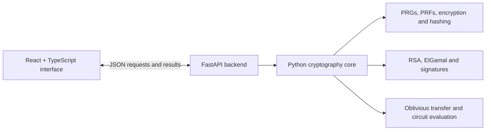

# Cryptographic Primitives & 2-Party MPC Engine

An interactive cryptography platform that connects low-level primitives, attack demonstrations, and two-party computation in one Python and React application. Explore how constructions work, inspect intermediate values, and compare vulnerable schemes with authenticated alternatives.

**Python · FastAPI · React · TypeScript · Applied Cryptography · Two-Party Computation**

## Highlights

- **20 cryptography modules** covering pseudorandomness, symmetric encryption, hashing, public-key cryptography, and two-party computation, plus a primitive-construction explorer.
- **Custom primitive implementations** including AES-128, GGM pseudorandom functions, block cipher modes, Merkle-Damgard hashing, RSA, ElGamal, and Schnorr signatures.
- **Attack demonstrations** for RSA padding oracles, Hastad's broadcast attack, birthday collisions, length extension, Diffie-Hellman interception, and ciphertext malleability.
- **Authenticated encryption** with Encrypt-then-MAC constructions, nonce/ciphertext authentication, and tag verification before decryption.
- **Two-party circuit engine** with ElGamal-based 1-out-of-2 oblivious transfer, OT-backed AND gates, and circuits for addition, equality, and the millionaires' comparison problem.
- **Interactive frontend** with mathematical explanations, editable inputs, visualizations, and step-by-step protocol and circuit traces.

## Architecture



During local development, Vite forwards `/api/*` requests to the backend at `127.0.0.1:8000`. Core Python modules can also be used independently of the web application.

## Cryptography modules

The `pa1.py` through `pa20.py` filenames identify the implementation modules. `pa0.py` provides an additional construction and reduction explorer.

| Area | Implemented capabilities | Source |
| --- | --- | --- |
| Pseudorandomness | One-way functions, HILL-style PRG, GGM PRF, monobit/runs/serial statistical checks | [pa1](backend/core/pa1.py), [pa2](backend/core/pa2.py) |
| Symmetric encryption | AES-128 PRP, PRF-based encryption, CBC/OFB/CTR modes, CPA game demonstrations | [pa2](backend/core/pa2.py), [pa3](backend/core/pa3.py), [pa4](backend/core/pa4.py) |
| Authentication | PRF-MAC, CBC-MAC, HMAC-style construction, Encrypt-then-MAC, tampering detection | [pa5](backend/core/pa5.py), [pa6](backend/core/pa6.py), [pa10](backend/core/pa10.py) |
| Hashing and collisions | Merkle-Damgard construction, discrete-log-based hashing, birthday and Floyd collision search | [pa7](backend/core/pa7.py), [pa8](backend/core/pa8.py), [pa9](backend/core/pa9.py) |
| Public-key encryption | Diffie-Hellman, textbook/padded RSA, Miller-Rabin, CRT decryption, ElGamal | [pa11](backend/core/pa11.py), [pa12](backend/core/pa12.py), [pa13](backend/core/pa13.py), [pa14](backend/core/pa14.py), [pa16](backend/core/pa16.py) |
| Signatures and composition | Hash-then-sign RSA, raw-RSA forgery examples, Schnorr signatures, signed ElGamal ciphertexts | [pa15](backend/core/pa15.py), [pa16](backend/core/pa16.py), [pa17](backend/core/pa17.py) |
| Two-party computation | Oblivious transfer, AND/XOR/NOT gates, Boolean circuits, addition, equality, comparison | [pa18](backend/core/pa18.py), [pa19](backend/core/pa19.py), [pa20](backend/core/pa20.py) |

## Attack demonstrations

| Experiment | What it illustrates |
| --- | --- |
| Bleichenbacher-style RSA padding oracle | How padding-validity responses can leak information in a toy RSA setting |
| Hastad's broadcast attack | Recovering a repeated plaintext encrypted with a small exponent under distinct RSA moduli |
| Birthday collision search | Collision-search cost as the digest size changes |
| Length extension | Why a naive secret-prefix Merkle-Damgard hash is unsuitable as a MAC |
| Diffie-Hellman interception | Why unauthenticated key exchange needs an authentication layer |
| Ciphertext bit flipping and ElGamal malleability | How encryption can permit modification, and how authentication detects tampering |

## Run locally

### Requirements

- Python 3.11+ recommended.
- Bun for the frontend; its package scripts invoke Bun directly.
- Optional: the Graphviz `dot` executable for rendering exported circuit diagrams. Textual DOT generation does not require it.

Clone your copy:

```bash
git clone https://github.com/Dataarnoor/pois-project.git
cd pois-project
```

### 1. Start the backend

In the first terminal:

```bash
cd backend
python3 -m venv .venv
source .venv/bin/activate
python -m pip install -r requirements.txt
python -m uvicorn main:app --reload --host 127.0.0.1 --port 8000
```

On Windows, use `python` to create the environment and `.venv\Scripts\activate` to activate it.

The API runs at [localhost:8000](http://localhost:8000). Interactive endpoint documentation is available at [localhost:8000/docs](http://localhost:8000/docs).

### 2. Start the frontend

In a second terminal, from the repository root:

```bash
cd frontend
bun install
bun dev
```

Open the local URL printed by Vite. Keep the backend running so the interactive demonstrations can call the API.

## Try the circuit engine directly

These examples run from the repository root and use the Python core without starting either web server:

```bash
# Add two 4-bit inputs
python3 backend/core/pa20.py addition -n 4 -x 5 -y 3

# Check whether two inputs are equal
python3 backend/core/pa20.py equality -n 4 -x 7 -y 7

# Compare Alice's and Bob's values: is x greater than y?
python3 backend/core/pa20.py millionaires -n 4 -x 9 -y 6
```

The engine builds Boolean circuits from AND, XOR, and NOT gates. AND gates call the oblivious-transfer implementation. The circuit runner reports input bits and computation results.

## Repository layout

```text
pois-project/
├── backend/
│   ├── main.py               # FastAPI endpoints and demo orchestration
│   ├── requirements.txt      # Backend dependencies
│   └── core/
│       ├── pa0.py            # Primitive construction/reduction explorer
│       ├── pa1.py ... pa17.py # Primitives, compositions, attacks and tests
│       └── pa18.py ... pa20.py # OT, gates and two-party circuit engine
├── frontend/
│   ├── src/components/demos/ # Interactive module demonstrations
│   ├── src/lib/              # Module catalogue, explanations and helpers
│   ├── src/routes/           # Dashboard and module pages
│   └── package.json          # Frontend dependencies and commands
└── README.md
```

## Implementation scope

The platform makes cryptographic behavior visible through small-parameter examples and intermediate-value traces. The Python core contains OT-backed gate evaluation; the web millionaires' endpoint evaluates the same circuit structure with plain bit operations to display its trace. Both inputs are supplied to one backend, so the web demonstration does not provide private computation between independent remote parties.

The PRG module includes selected NIST SP 800-22 statistical tests (monobit, runs, and serial), rather than the full test suite. Tag comparison uses a custom byte-comparison routine; Python execution does not provide a formally verified constant-time guarantee. These implementations are intended for experimentation and analysis.

## Attribution

This repository is a fork of [gautambhetanabhotla/pois-project](https://github.com/gautambhetanabhotla/pois-project). Original contributors and implementation history are preserved in Git history.
